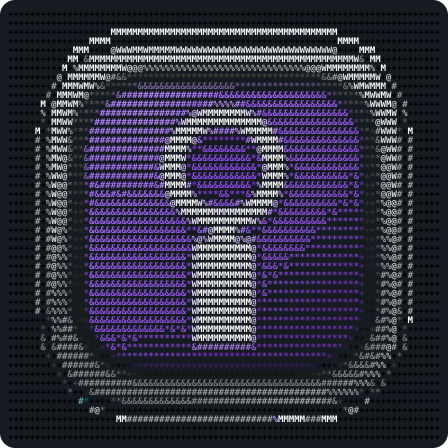
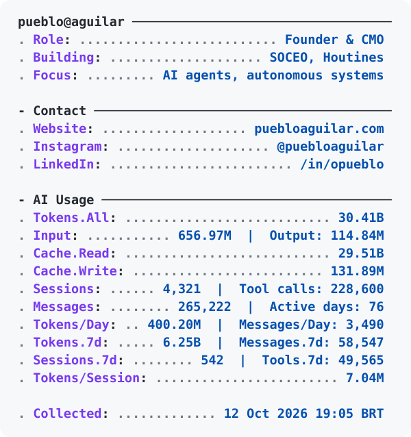

<table width="100%">
  <tr>
    <td width="37%" align="center" valign="middle">
      <picture>
    <source media="(prefers-color-scheme: dark)" srcset="assets/profile-symbol-dark.svg">
    
  </picture>
      <h3><a href="https://www.instagram.com/puebloaguilar/">PUEBLO AGUILAR</a> <a href="https://www.soceo.ai/">SOCEO.AI</a></h3>
    </td>
    <td width="63%" valign="middle">
      <picture><source media="(prefers-color-scheme: dark) and (max-width: 680px)" srcset="assets/profile-metrics-dark-mobile.svg"><source media="(max-width: 680px)" srcset="assets/profile-metrics-light-mobile.svg">
    <source media="(prefers-color-scheme: dark)" srcset="assets/profile-metrics-dark.svg">
    
  </picture>
    </td>
  </tr>
</table>

  <a href="https://soceo.ai/">SOCEO</a> ·
  <a href="https://houtines.com/">Houtines</a> ·
  <a href="https://www.puebloaguilar.com/">Website & AI dashboard</a> ·
  <a href="https://instagram.com/puebloaguilar">Instagram</a> ·
  <a href="https://linkedin.com/in/opueblo">LinkedIn</a>

