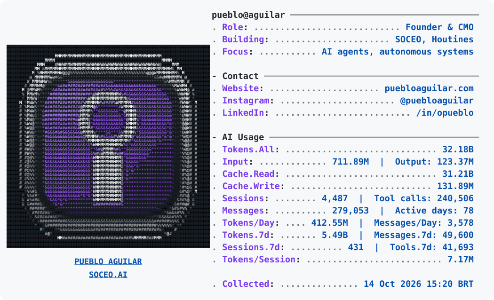

<a href="https://www.puebloaguilar.com/">
  <picture>
    <source media="(prefers-color-scheme: dark) and (max-width: 680px)" srcset="assets/profile-dark-mobile.svg">
    <source media="(max-width: 680px)" srcset="assets/profile-light-mobile.svg">
    <source media="(prefers-color-scheme: dark)" srcset="assets/profile-dark.svg">
    
  </picture>
</a>

  <a href="https://soceo.ai/">SOCEO</a> ·
  <a href="https://houtines.com/">Houtines</a> ·
  <a href="https://www.puebloaguilar.com/">Website & AI dashboard</a> ·
  <a href="https://instagram.com/puebloaguilar">Instagram</a> ·
  <a href="https://linkedin.com/in/opueblo">LinkedIn</a>

About the AI metrics

These are recorded usage totals, including cache tokens and subagent activity. Sessions are distinct recorded sessions, not sums of daily counts. The panel shows lifetime totals from **2026-03-08 to 2026-10-11**, plus the last seven days.

The collection timestamp comes from the source data. An hourly refresh keeps the latest valid snapshot; temporary source failures preserve the last collection. GitHub may delay scheduled runs.

Public sources: [Pueblo's AI usage](https://www.puebloaguilar.com/api/ai-usage) and [SOCEO's shared snapshot](https://soceo.ai/data/pueblo-ai-usage.json). Only aggregate counters are stored in this repository.

Visual direction: [Andrew6rant's profile](https://github.com/Andrew6rant). Original SVG implementation; see [.references/README.md](.references/README.md) for research and licenses.

